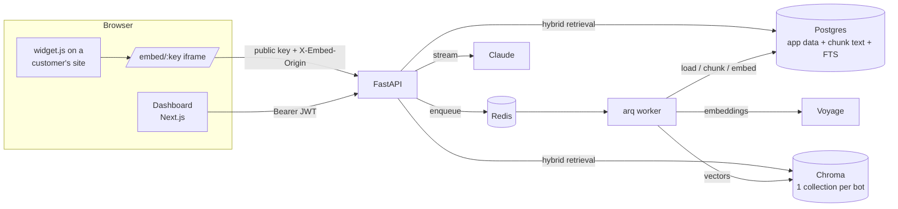
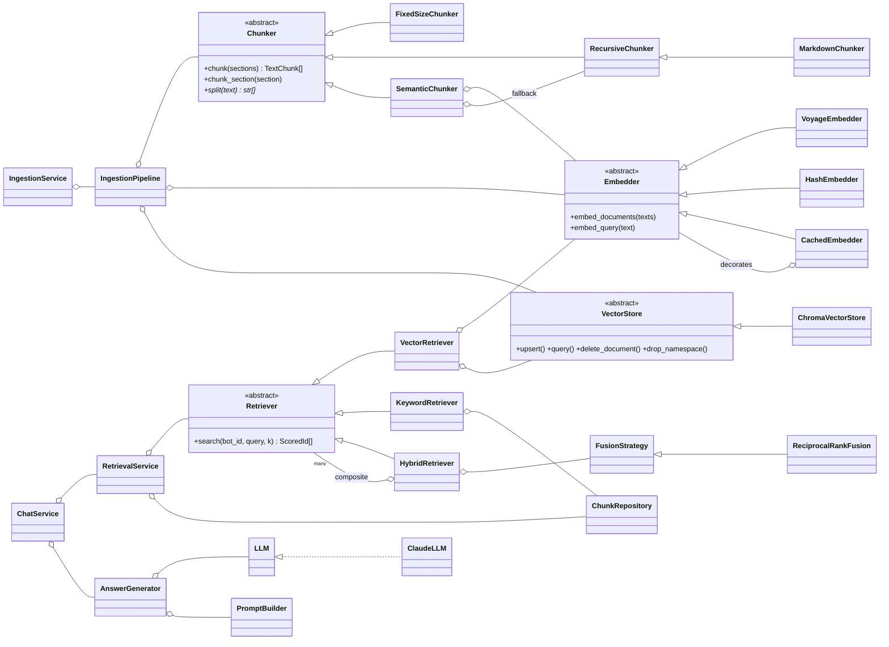

# DocBot Architecture

## System overview

Two request paths matter:

1. **Ingestion (async).** `POST /documents/upload` validates the file, stores it under a random name, writes a `queued` row and enqueues a job. The worker runs `IngestionService` → `IngestionPipeline`: load → chunk (the bot's strategy) → dedupe → persist text → batch-embed → upsert vectors.
2. **Chat (streaming).** `ChatService.chat_turn` checks the quota, loads the last N messages, runs `RetrievalService` (vector + keyword → RRF), streams Claude's answer over SSE, then stores the turn and a `QueryLog` row for analytics.

## Low-level design

| Pattern | Where | Why |
|---|---|---|
| **Strategy** | `Chunker`, `Embedder`, `Retriever`, `FusionStrategy`, `LLM` | Swap algorithms per bot or per environment without touching callers |
| **Registry + Factory** | `rag/chunking/registry.py`, `factory.py`, `embeddings/factory.py` | A new chunker is one decorated class, and the API lists it automatically |
| **Template Method** | `Chunker.chunk()` → `split()` | Shared section walking; strategies only implement splitting |
| **Composite** | `HybridRetriever` | A hybrid retriever *is a* retriever, so vector-only, keyword-only and hybrid share one interface (the eval harness relies on this) |
| **Decorator** | `CachedEmbedder` | Adds LRU caching to any embedder transparently |
| **Adapter / Port** | `ChromaVectorStore`, `ClaudeLLM`, `VoyageEmbedder` | Vendor SDKs stay at the edge; Chroma could be replaced by pgvector or Qdrant with one class |
| **Repository** | `repositories/*` | SQL in one place; every tenant-scoped query takes `bot_id` |
| **Pipeline** | `IngestionPipeline` | Explicit stages: chunk → dedupe → persist → embed → upsert |
| **Service layer + Composition root** | `services/*`, `container.py` | Routers stay thin; all wiring in one module; tests override any provider |

## Chunking strategies

| Strategy | How it splits | Good for |
|---|---|---|
| `fixed` | Sliding token window with overlap | Baseline; unstructured text |
| `recursive` | Paragraph → line → sentence → clause → word, then greedy packing with tail overlap | Prose without headings |
| `markdown` (default) | Splits on the heading hierarchy first (never straddles two headings), then recursive inside; stores the heading path, e.g. `Billing > Refunds` | Docs, help centers, wikis |
| `semantic` | Embeds sentences; cuts where adjacent-sentence cosine distance is in the top 10% for the section; oversize groups fall back to recursive | Long mixed-topic pages |

All strategies also get:

- **Contextual chunk headers:** `title + heading path` is prepended before embedding, so "It takes 5 days" is embedded as being about refunds.
- **Deduplication:** a hash set over normalized text drops repeated nav bars and footers in O(n).
- **Page tracking for PDFs:** citations can say "page 4".

Run `python -m evals.run_eval` to compare them (see the README for results).

## Algorithms and complexity

| Concern | Choice | Cost |
|---|---|---|
| Dense search | Chroma HNSW (cosine) | ~O(log n) per query |
| Lexical search | Postgres `tsvector` + GIN index, OR-query over the question's lexemes, `ts_rank_cd` | Index lookup on matching postings only |
| Fusion | Reciprocal Rank Fusion: one hash-map pass + `heapq.nlargest` | O(N + N log k) vs O(N log N) for a full sort |
| Hydration | One `WHERE id = ANY(:ids) AND bot_id = :bot` query | 1 round trip, not k |
| Query-embedding cache | `OrderedDict` LRU | O(1) get / put / evict |
| Rate limiting | Fixed-window `INCR` + `EXPIRE`, pipelined | O(1), one Redis round trip |
| Crawl | BFS with `deque` + visited `set` | O(1) enqueue/dequeue/membership |
| Chunk insert | Bulk `INSERT … RETURNING` with `sort_by_parameter_order` | 1 round trip for all chunks |
| Bot list | Correlated scalar subqueries for counts | 1 query, not 1 + 2N |
| Analytics | Composite index `(bot_id, created_at)`; `generate_series` zero-fills days | Index range scan |
| Conversation history | `ORDER BY seq DESC LIMIT n` in SQL | Constant per turn regardless of thread length |
| Eval BM25 | Inverted index `term → {doc: tf}` | Touches only postings of query terms |

## Security model

| Threat | Mitigation | Test |
|---|---|---|
| Cross-tenant data leak | Per-bot Chroma collection **and** every SQL read filters `bot_id`; hydration drops ids not owned by the bot | `test_service_drops_chunks_owned_by_another_tenant`, `test_keyword_search_ranks_matches_and_isolates_tenants` |
| IDOR on bots/documents | Lookups include `owner_id`; other users get **404** (not 403) | `test_bot_crud_and_ownership` |
| Conversation hijacking | A client-supplied `conversation_id` is honoured only if it belongs to the bot | `test_conversation_cannot_be_hijacked_across_bots` |
| SSRF via crawler | http(s) only, no credentials in URL, every resolved IP must be public, **each redirect hop re-checked**, 5 MB page cap | `test_blocks_unsafe_urls`, `test_crawl_checks_redirect_targets_against_guard` |
| Malicious uploads | Extension allowlist, magic-byte check (`%PDF-`), NUL-byte check for text, 20 MB cap enforced while streaming, stored under a random UUID name (no path traversal) | `test_validate_upload_rejects`, `test_upload_validates_and_enqueues` |
| Prompt injection from documents | Retrieved text is HTML-escaped inside `<source>` tags; the system prompt says source text is data, not instructions | `test_prompt_escapes_markup_in_untrusted_content` |
| SQL / tsquery injection | Parameterized SQL everywhere; each lexeme `quote_literal`'d before `to_tsquery` | `test_keyword_search_survives_hostile_query_syntax` |
| Credential stuffing | Per-IP login rate limit; bcrypt; constant-time path for unknown emails; identical error for wrong email/password | `test_login_is_rate_limited`, `test_duplicate_signup_and_bad_login` |
| Widget abuse / cost | Per-bot+IP rate limit, monthly quota, optional origin allowlist, key rotation | `test_public_widget_*`, `test_chat_enforces_monthly_quota` |
| Clickjacking / sniffing | `X-Frame-Options: DENY`, `nosniff`, `Referrer-Policy`, `Permissions-Policy` | `test_security_headers_and_health` |
| CSRF | Bearer tokens instead of cookies; CORS allowlist without credentials | n/a |

Known limits in v1:

- **The origin check is advisory.** `X-Embed-Origin` comes from the embedding page, and a script outside a browser can forge it. The rate limit and quota are the hard controls.
- **DNS rebinding.** An attacker could change a DNS answer between the SSRF check and the fetch. Pinning the resolved IP for the connection would close this.
- **Token storage.** JWTs are kept in `localStorage`. An httpOnly cookie behind a same-site proxy would be stronger against XSS.
